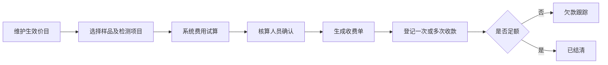
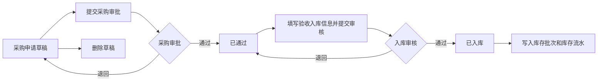
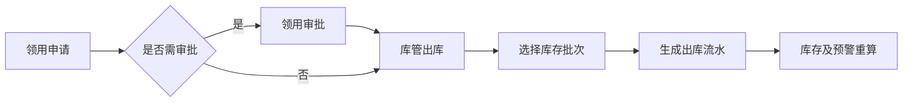
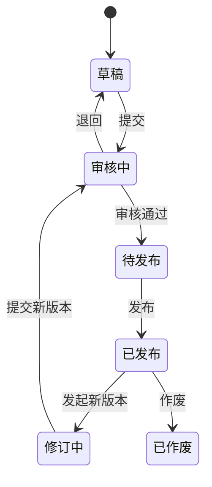
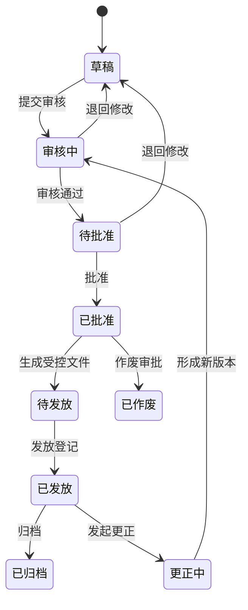

# 产品与核心流程设计（V0.1）

## 1. 产品导航

系统采用统一工作台，一级导航建议如下：

| 一级模块 | 二级功能 |
| --- | --- |
| 工作台 | 我的待办、我的提醒、快捷入口、业务概览 |
| 财务管理 | 价目管理、费用试算、收费单、收款登记、欠款、成本与统计 |
| 物料管理 | 物料档案、采购与入库、物料信息库（领用出库）、库存流水、供应商、盘点、处置、预警；默认进入物料信息库 |

物料档案删除规则：物料编码对应的档案只要已存在于物料信息库（包含零库存批次）或采购申请中，就不允许删除；删除按钮置灰，悬停显示具体引用原因。仅同时未被物料信息库和采购申请引用的档案允许删除，后端删除接口执行相同校验。
| 文件管理 | 文件库、我的草稿、审核发布、版本历史、复审提醒 |
| 报告管理 | 模板、报告编制、待审核、待批准、用印、发放、归档、查询统计 |
| 系统管理 | 组织、岗位、用户、角色、权限、字典、参数、编号、通知、任务、日志 |

没有样例模板时，系统提供简洁的内置模板。模板只保证一期数据闭环，不宣称替代实验室最终受控格式；正式上线前由业务负责人确认字段、版式和编号。

## 2. 通用状态与操作原则

- `草稿`：创建人可编辑、删除或提交。
- `审批中`：业务字段锁定，仅允许审批、撤回（尚无人处理时）和查看。
- `已通过/已发布/已批准`：形成受控版本，禁止原地覆盖修改。
- `已退回`：回到创建人修改，保留退回意见和历史版本。
- `已作废`：保留记录和原因，不参与正常业务统计。
- 所有状态变化必须经过后端校验，保存操作者、时间、意见和状态前后值。
- 任何人不得审批自己创建且制度要求职责分离的单据；系统按流程配置执行互斥规则。

## 3. 财务流程

关键规则：

- 价目按版本和有效期生效，历史收费单保留当时价格快照。
- 未被收费单引用的价目可修改或删除；一旦被任意收费单引用，界面应将修改、删除操作置灰并提示原因，后端同时强制拒绝相关请求。
- 界面将 `ENABLED/DISABLED`、`DRAFT/CONFIRMED/PART_PAID/PAID/VOID` 等内部状态码转换为中文标签；收费单项目选择器仅加载启用价目，后端费用试算仍需再次校验价目状态。
- 折扣默认需要具备折扣权限的人员确认，并记录原因。
- 收费单确认后不得改写金额；错误通过作废重开或调整单处理。
- `DRAFT` 在界面显示为“待确认”，可修改或删除；`CONFIRMED` 显示为“待收款”，在尚未发生任何收款时可退回“待确认”。退回必须清除原确认人和确认时间并保留审计记录。
- 一笔收费单允许多次收款，累计实收不得无授权超过应收。
- 一期不对接开票和外部财务系统，仅记录内部收费事实并导出。

## 4. 采购与库存流程

关键规则：

- 库存以仓库、库位、物料和批次为最小核算维度。
- 普通物料默认先进先出或近效期先出；库管可在授权下调整并说明原因。
- 每次入出库必须生成不可变库存流水，现存量与流水汇总定期核对。
- 负库存默认禁止；盘盈盘亏必须通过盘点审核生成调整流水。
- 危险品标记后启用更严格的审批、领用人、用途和双人确认扩展字段。
- 物料危险属性、采购申请状态、库存流水业务类型和出入库方向在数据库及接口中使用英文编码，在用户界面统一转换为中文标签。
- 物料信息库支持按编码、名称、批次、仓库、库位和预警状态组合查询，查询结果支持导出 Excel 兼容文件和打印。
- 库存数量为零时预警状态为 `OUT_OF_STOCK`，界面显示“无库存”并将整行置灰；无库存批次不得出现在领用出库选择列表，后端同时禁止超库存出库。

## 5. 文件生命周期

关键规则：

- 文件由稳定的文件编号和多个版本组成，同一时刻最多一个有效发布版本。
- 发布版本不可替换附件；修订必须创建新版本。
- 浏览、下载和打印按文件密级、部门范围、角色和用户授权综合判断。
- 作废后仍可供有审计权限的人员查询，不再出现在普通有效文件列表。

## 6. 报告生命周期

关键规则：

- 一期默认一级审核、一级批准，二者角色分离并可配置。
- 报告批准时固化业务数据快照、模板版本、生成文件和文件哈希。
- 无电子签章时，用印只记录审批、印章类型、经办人、时间和纸质份数，不生成具有法律效力的电子签名。
- 已批准报告只能通过作废或更正流程处理；更正版本必须关联原报告。
- 报告编号由编号规则服务生成并保证唯一，正式规则待业务确认。

## 7. 内置模板范围

一期先提供以下基础模板：收费单、采购申请单、验收入库单、领用出库单、库存盘点表、文件审批单、通用中文检测报告、报告审批单和归档登记表。

模板管理需支持：字段占位符、表格明细、日期/数字格式、模板版本、生效状态、预览测试和导入导出。第一版不实现无限制网页拖拽排版。
