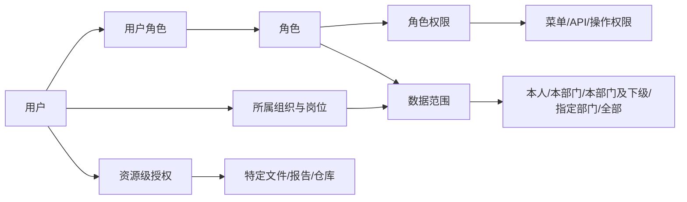

# 权限管理设计（V0.1）

## 1. 权限模型

采用 `用户—角色—权限` 为主体的 RBAC，并叠加组织数据范围、资源授权和职责分离规则。

授权判定顺序：账号状态与会话校验 → API 功能权限 → 数据范围 → 资源级授权 → 业务状态与职责分离 → 审计记录。

## 2. 权限粒度

| 类型 | 示例 |
| --- | --- |
| 菜单权限 | 是否显示物料管理、报告管理 |
| 操作权限 | 新增、编辑、删除、提交、审核、批准、导出、打印、作废 |
| API 权限 | 后端接口权限码，必须与操作权限一致校验 |
| 数据范围 | 本人、本部门、本部门及下级、指定部门、全部 |
| 资源权限 | 指定仓库、文件分类、报告类型、密级或单位 |
| 字段权限 | 身份信息、价格、成本等敏感字段的查看或编辑 |
| 状态权限 | 仅允许在特定业务状态执行操作 |

权限码统一采用 `领域:资源:动作`，例如：

- `system:user:create`
- `inventory:stock:view`
- `inventory:receipt:approve`
- `finance:charge:confirm`
- `document:file:publish`
- `report:report:approve`
- `audit:operation:view`

## 3. 默认角色矩阵

图例：`管`=管理，`办`=办理，`审`=审核/审批，`查`=查询，`—`=默认无权。最终以单位制度配置为准。

| 功能 | 系统管理员 | 实验室负责人 | 财务人员 | 采购人员 | 库管人员 | 检测人员 | 文件管理员 | 报告编制 | 报告审核 | 报告批准 | 质量人员 | 审计人员 |
| --- | --- | --- | --- | --- | --- | --- | --- | --- | --- | --- | --- | --- |
| 组织用户角色 | 管 | 查 | — | — | — | — | — | — | — | — | 查 | 查 |
| 系统参数字典 | 管 | 查 | — | — | — | — | — | — | — | — | 查 | 查 |
| 价目与收费 | — | 查/审 | 管 | 查 | — | 查 | — | 查 | 查 | 查 | 查 | 查 |
| 收款与欠款 | — | 查 | 管 | — | — | — | — | — | — | — | 查 | 查 |
| 采购申请 | — | 审/查 | 查 | 管 | 查 | 办 | — | — | — | — | 查 | 查 |
| 验收入库 | — | 查 | 查 | 办 | 管 | — | — | — | — | — | 查 | 查 |
| 领用出库 | — | 查/审 | — | — | 管 | 办 | — | — | — | — | 查 | 查 |
| 库存盘点处置 | — | 审/查 | 查 | — | 管 | — | — | — | — | — | 审/查 | 查 |
| 文件起草 | — | 查 | — | — | — | 办 | 管 | — | — | — | 办 | 查 |
| 文件审核发布 | — | 审/查 | — | — | — | 查 | 管 | — | — | — | 审/查 | 查 |
| 报告模板 | — | 查 | — | — | — | 查 | — | 管 | 查 | 查 | 审/查 | 查 |
| 报告编制 | — | 查 | — | — | — | 办 | — | 管 | 查 | 查 | 查 | 查 |
| 报告审核 | — | 查 | — | — | — | — | — | 查 | 审 | 查 | 查 | 查 |
| 报告批准 | — | 管 | — | — | — | — | — | 查 | 查 | 审 | 查 | 查 |
| 用印发放归档 | — | 审/查 | — | — | — | — | — | 办 | 查 | 查 | 审/办 | 查 |
| 业务审计日志 | — | 查 | — | — | — | — | — | — | — | — | 查 | 管 |
| 安全审计日志 | 查 | 查 | — | — | — | — | — | — | — | — | 查 | 管 |

系统管理员默认不拥有财务确认、库存审批或报告批准等业务权力，避免技术管理权自动扩大为业务审批权。

## 4. 职责分离

- 用户不能审核自己提交的采购、文件或报告，除非制度明确允许且系统参数显式开启。
- 报告编制、审核、批准默认由不同人员完成。
- 库管人员不能独自审批本人发起的盘点差异或危险品领用。
- 权限管理员不能审批自己的角色提升；由另一名授权管理员复核。
- 审计人员只读，不能修改业务数据或系统配置。

## 5. 账号和安全策略

- 账号唯一、禁止共享；离职或停用立即禁止登录但保留历史归属。
- 初始密码首次登录强制修改；密码复杂度、有效期和历史次数可配置。
- 连续登录失败触发临时锁定，管理员解锁需要记录原因。
- 支持强制下线、会话超时、同账号并发会话数限制。
- 高风险操作要求再次输入密码确认；后续可扩展双因素认证。
- 用户、角色、权限、数据范围的每次变化均记录变更前后值。

## 6. 权限测试要求

- 每个受保护 API 至少包含有权、无权、跨部门越权和失效会话测试。
- 对文件下载、报告导出、成本字段和审计日志重点执行直接 URL 越权测试。
- 角色变更后现有会话应在可配置时间内失效，紧急停用应立即生效。
- 200 并发场景下权限校验不能依赖逐请求的大量数据库查询，应使用可失效缓存。

