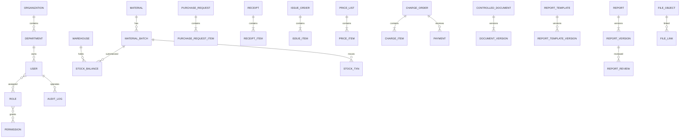

# 领域数据模型（V0.1）

## 1. 领域关系概览

## 2. 通用字段规范

除纯关联表外，业务表统一包含：

| 字段 | 类型建议 | 说明 |
| --- | --- | --- |
| id | bigint/UUID | 内部主键；具体策略在数据库选型后确定 |
| tenant_id | bigint | 单位隔离键，一期单单位也保留 |
| created_by / created_at | bigint / timestamp | 创建人和创建时间 |
| updated_by / updated_at | bigint / timestamp | 最后修改人和时间 |
| version | integer | 乐观锁版本 |
| deleted | boolean | 仅适用于允许逻辑删除的草稿或配置数据 |

受控记录额外包含 `status`、`submitted_by/at`、`approved_by/at`、`void_reason` 等生命周期字段。历史事实表和审计表不提供普通逻辑删除。

## 3. 身份与权限

| 表 | 关键字段 | 说明 |
| --- | --- | --- |
| sys_organization | code, name, status | 单位信息 |
| sys_department | parent_id, code, name, path | 树形部门 |
| sys_position | code, name | 岗位 |
| sys_user | username, password_hash, dept_id, status | 用户账号 |
| sys_user_position | user_id, position_id, primary_flag | 用户岗位 |
| sys_role | code, name, status, built_in | 角色 |
| sys_permission | code, type, resource, action | 菜单、操作和 API 权限 |
| sys_user_role | user_id, role_id, valid_from, valid_to | 用户角色，可设置有效期 |
| sys_role_permission | role_id, permission_id | 角色授权 |
| sys_role_data_scope | role_id, scope_type, dept_id | 数据范围 |
| sys_resource_grant | subject_type/id, resource_type/id, actions | 文件、仓库等资源授权 |
| sys_login_log | user_id, result, ip, user_agent, occurred_at | 登录审计 |

## 4. 财务领域

| 表 | 关键字段 | 说明 |
| --- | --- | --- |
| fin_price_list | code, name, version_no, valid_from/to, status | 价目版本 |
| fin_price_item | price_list_id, test_item_code, unit, unit_price | 检测项目价格 |
| fin_charge_order | order_no, customer_name, total_amount, discount_amount, receivable_amount, paid_amount, status | 收费单 |
| fin_charge_item | charge_order_id, item_code, quantity, unit_price, discount_rate, amount, price_snapshot | 收费明细及价格快照 |
| fin_payment | payment_no, charge_order_id, amount, method, paid_at, operator_id | 收款记录 |
| fin_adjustment | charge_order_id, type, amount, reason, status | 调整/冲销扩展 |
| fin_cost_item | item_code, unit_cost, valid_from/to | 单项成本基线 |

金额建议 `decimal(18,2)`；检测数量按业务需要使用 `decimal(18,6)`。收费单号、收款单号建立唯一索引。

## 5. 物料领域

| 表 | 关键字段 | 说明 |
| --- | --- | --- |
| inv_material | code, name, category, specification, base_unit, hazard_type, min_stock | 物料主数据 |
| inv_supplier | code, name, qualification_expiry, status | 供应商 |
| inv_warehouse | code, name, manager_id | 仓库 |
| inv_location | warehouse_id, code, name | 库位 |
| inv_purchase_request | request_no, applicant_id, dept_id, status | 采购申请 |
| inv_purchase_request_item | request_id, material_id, qty, expected_date, purpose | 申请明细 |
| inv_receipt | receipt_no, supplier_id, warehouse_id, accepted_by, status | 验收入库单 |
| inv_receipt_item | receipt_id, material_id, batch_no, qty, unit_price, production_date, expiry_date, result | 入库批次明细 |
| inv_material_batch | material_id, batch_no, supplier_id, expiry_date, quality_status | 物料批次 |
| inv_issue_order | issue_no, applicant_id, dept_id, purpose, status | 领用单 |
| inv_issue_item | issue_id, material_id, batch_id, qty | 领用明细 |
| inv_stock_txn | biz_type/id, material_id, batch_id, warehouse_id, location_id, direction, qty, unit_cost, occurred_at | 不可变库存流水 |
| inv_stock_balance | material_id, batch_id, warehouse_id, location_id, qty, avg_cost, version | 库存余额 |
| inv_stocktake | stocktake_no, warehouse_id, status | 盘点单 |
| inv_stocktake_item | stocktake_id, material_id, batch_id, book_qty, actual_qty, difference | 盘点明细 |
| inv_disposal | disposal_no, material_id, batch_id, qty, reason, status | 报废/销毁记录 |

库存余额唯一键为物料、批次、仓库、库位组合。出库在同一数据库事务内锁定余额并写流水，防止并发超领。

## 6. 文件领域

| 表 | 关键字段 | 说明 |
| --- | --- | --- |
| doc_category | parent_id, code, name | 文件分类 |
| doc_controlled | document_no, title, category_id, security_level, owner_dept_id, current_version_id, status | 受控文件 |
| doc_version | document_id, version_no, file_id, revision_note, status, effective_at, review_due_at | 文件版本 |
| doc_review | version_id, reviewer_id, decision, comment, reviewed_at | 审核记录 |
| doc_access_rule | document/category_id, subject_type/id, actions | 浏览、下载、打印授权 |
| doc_read_log | document_id, version_id, user_id, action, occurred_at | 阅读下载记录 |

## 7. 报告领域

| 表 | 关键字段 | 说明 |
| --- | --- | --- |
| rpt_template | code, name, report_type, current_version_id, status | 报告模板 |
| rpt_template_version | template_id, version_no, source_file_id, schema_json, status | 模板版本与字段定义 |
| rpt_report | report_no, report_type, customer_name, current_version_id, status | 报告主记录 |
| rpt_report_version | report_id, version_no, template_version_id, data_snapshot, generated_file_id, file_hash, status | 报告受控版本 |
| rpt_review | report_version_id, stage, reviewer_id, decision, comment, occurred_at | 审核与批准记录 |
| rpt_seal_record | report_version_id, seal_type, approver_id, operator_id, copies, occurred_at | 纸质用印记录 |
| rpt_distribution | report_version_id, recipient, method, copies, distributed_by/at | 发放登记 |
| rpt_archive | report_version_id, location, archived_by/at, retention_until | 归档信息 |
| rpt_correction | original_report_id, new_report_id, reason, status | 更正关联 |

## 8. 平台、附件和审计

| 表 | 关键字段 | 说明 |
| --- | --- | --- |
| plat_file_object | storage_provider, object_key, original_name, size, mime, sha256 | 文件对象 |
| plat_file_link | file_id, biz_type, biz_id, purpose | 附件关联 |
| plat_dictionary | type, code, name, sort, status | 数据字典 |
| plat_sequence_rule | biz_type, pattern, current_value | 编号规则 |
| plat_notification | recipient_id, type, title, content, read_at | 站内通知 |
| plat_job | job_type, payload, status, retry_count | 异步任务 |
| audit_operation | actor_id, action, object_type/id, before_summary, after_summary, ip, occurred_at | 操作审计 |
| audit_export | actor_id, resource_type, query_summary, file_id, occurred_at | 导出审计 |

## 9. 数据库兼容性约束

- 标准字段优先使用 varchar、decimal、timestamp、boolean 和大文本，避免业务层依赖数据库枚举类型。
- JSON 仅保存模板结构、快照等不参与核心关系查询的数据，并通过适配层处理厂商差异。
- 不在业务 SQL 中直接依赖 PostgreSQL 特有数组、操作符或全文检索。
- 所有表、索引和约束通过 Flyway 脚本版本化；每种目标国产数据库必须执行全量迁移和回归测试。

